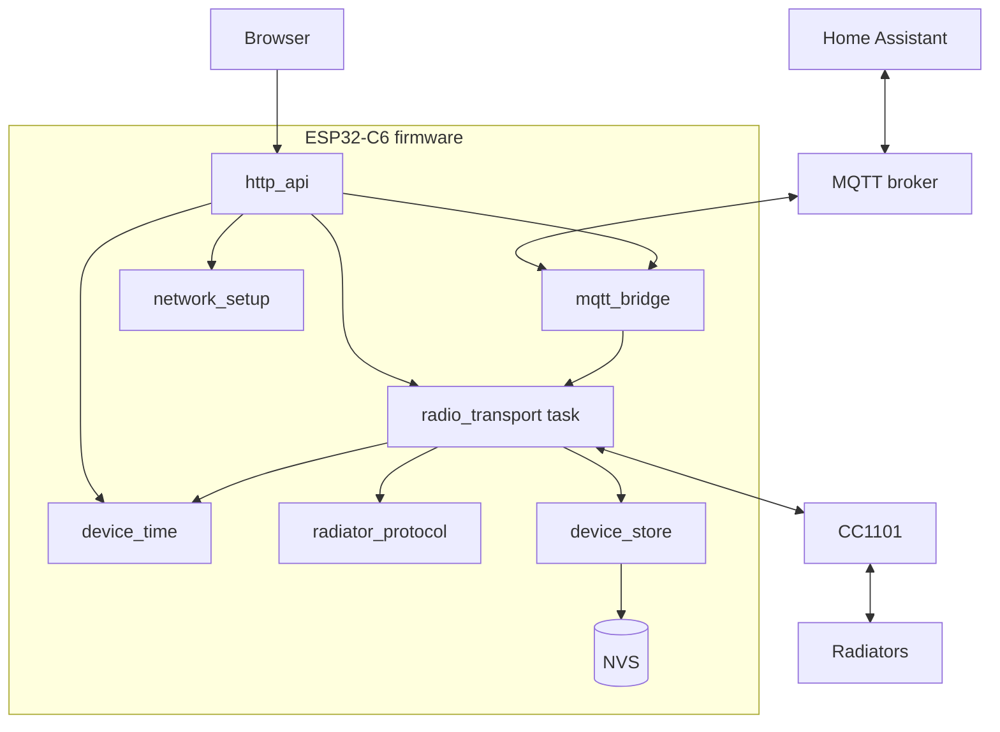

# Architecture

Cleverbox is experimental firmware for controlled development. It favours
simple code and visible errors over automatic recovery. See
[production hardening](production-hardening.md) for what is deliberately left out.

## Overview

| Component | Responsibility |
| --- | --- |
| `radiator_protocol` | Frame codec, CRCs, generated controller profile, pairing and command state machines. Portable C. |
| `radio_transport` | CC1101 through RadioLib, the radio task, radiator registry in RAM, command queue, observations |
| `device_store` | NVS helpers and the registry record |
| `network_setup` | Wi-Fi station, setup access point, BOOT button. Portable policy plus an ESP-IDF adapter. |
| `device_time` | Manual and SNTP time, POSIX time zone, command clock |
| `mqtt_bridge` | Broker settings, commands, snapshots, Home Assistant discovery. ESP-MQTT adapter. |
| `main` | Startup, HTTP API (`http_api.c`), web page (`index.html`) |

Dependencies: ESP-IDF 5.5.1 (FreeRTOS, Wi-Fi, HTTP server, NVS, SNTP,
ESP-MQTT, cJSON) and RadioLib 7.8.1 with its bundled ESP-IDF HAL
([RadioLib notes](radiolib.md)).

## Tasks

| Task | Does |
| --- | --- |
| `radio` | Owns the CC1101. Every 1 ms: read the FIFO, advance pairing and command, send at most one frame. |
| HTTP server | Handles requests. Settings changes are saved before the response. |
| `mqtt_bridge` | Every 100 ms: starts and stops the client, publishes discovery and snapshots |
| ESP-MQTT client | Reconnects by itself; runs command callbacks |
| `network` | Every 100 ms: reconnects Wi-Fi and samples the BOOT button |

`radio_transport` keeps its shared state (registry, queue, pairing, status)
behind one mutex. HTTP and MQTT callers change it directly under that mutex.
SPI calls run outside the mutex; registry NVS writes run inside it.

## Radiator registry

Each record has a stable numeric ID, a name (1–32 bytes, no control
characters), the radiator's RF address and, if Cleverbox is its controller, the
controller address. A record without a controller address is **monitored**:
Cleverbox shows its reports from any controller but never sends to it. A record
with one is **paired**: its reports must come from the radiator to that
controller, and it accepts commands.

IDs increase and are never reused. Each pairing attempt reserves an ID when it
starts, so a failed attempt leaves a gap. Capacity is
`CLEVERBOX_RADIATOR_CAPACITY` (default 16) records.

ID, name and addresses are saved in NVS (`registry`) after every change. The
latest report and command result are RAM-only. A registry that fails to load is
reported in `registry_error` and starts empty; the next change overwrites it.

## Receive path

The radio task polls `RXBYTES` over SPI; no interrupts are used. It accepts a
count only when two consecutive reads agree and never empties the FIFO while a
frame is incomplete (TI erratum SWRZ020E). The CC1101 runs in infinite packet
mode so the length byte and both software CRCs stay in the FIFO. A frame is a
length byte `L` (≥ 11) plus `L + 2` bytes. After a complete frame, an overflow
or 100 ms without completion, the task restarts reception.

Every CRC-valid frame updates `last_frame`. Decoded reports update:

- the observation cache: the latest report per radiator address, any controller
  (`2 × capacity` entries; when full, the oldest is replaced);
- matching records: monitored by radiator address, paired by both addresses;
- the running pairing or command.

## Pairing

One pairing at a time, and only when no command is queued or running.

| Phase | Action | Ends when |
| --- | --- | --- |
| `offer` | Send an offer to the discovery address | Sent |
| `waiting_reply` | Wait for an inclusion reply to the controller | Reply (radiator address learned) or 5 s |
| `bind` | Send bind 1 s after the reply | Sent |
| `waiting_ack` | Wait for the radiator's ack | Ack or 5 s |
| `complete` | Record added and saved | – |

A reply from an address already in the registry ends the attempt before bind
(`already_registered`). Cancel stops the remaining steps; a bind already sent
stays sent. If saving fails, the record still exists until restart and the
error is shown.

## Commands

Commands run one at a time, oldest first. Each radiator has at most one queued
or running command; another is refused as `busy`. Admission requires a paired
radiator, a ready radio, no pairing and usable device time.

| Phase | Meaning | Next |
| --- | --- | --- |
| `queued` | Waiting for the radio | Started → `poll` |
| `poll` | Poll to send | Sent → `waiting_report` |
| `waiting_report` | Waiting for a report | Report → `sending` |
| `sending` | State frame built from the request and that report | Sent → `waiting_readback` |
| `waiting_readback` | Waiting for a report with the requested target and mode | Match → `matched`; mismatch after one attempt → `sending` |
| `matched` | A report showed the requested settings | Terminal |
| `timeout` | A wait expired | Terminal |
| `error` | Radio or time failure | Terminal |

- Every wait is 150 s. A silent radiator therefore holds the queue for 150 s.
- At most two state frames per command; the second only after a new
  mismatching report.
- Each state frame uses the [generated controller profile](controller-profile.md)
  with the report that answered the poll. Its clock is the local time when the
  command started plus the elapsed seconds.
- After `timeout` or `error`, a later matching report changes the result to
  `matched` without sending anything.
- `matched` means the radiator reported the requested values. It does not prove
  the command caused them or that heating changed.
- Commands are not saved. Boot sends nothing.

Before sending, the task requires an empty FIFO and no partial frame. It sends
with RadioLib's blocking `transmit()` (fixed length, bounded by RadioLib's
timeout) and then returns to infinite-length receive. Frames that start during
a transmission are lost.

## Radio errors

`ready` means the CC1101 was set up and is receiving. A setup, receive or
transmit error stops the radio: `ready` turns false, `error` and `error_stage`
record the failure, the running pairing or command ends with that error and
queued commands end with `radio_not_ready`. Nothing retries automatically.
`POST /api/radio {"action":"retry"}` sets the radio up again, or restart the
device. Retry never resumes failed work. The last error stays visible.

## Time

Commands carry local time of day. Time is usable after an SNTP sync or a
manual UTC set during this boot. SNTP (`pool.ntp.org`) starts when the station
gets an address and resyncs hourly. The time zone is a POSIX rule with explicit
DST transitions (default `UTC0`), saved in NVS. Supported syntax (max 95
bytes): `STDoffset[DST[offset],Mm.w.d[/time],Mm.w.d[/time]]`. Sweden:
`CET-1CEST,M3.5.0/2,M10.5.0/3`. All deadlines and ages use the monotonic timer.

## Network

| Situation | Behaviour |
| --- | --- |
| No saved Wi-Fi | Setup AP on |
| Saved Wi-Fi | Station only; connect at boot |
| Connection lost or failed | Retry every 5 s |
| Configure | Save, then connect. The AP stays as it is. |
| BOOT held 5 s, then released | Setup AP on |
| Close setup AP | AP off (only with saved Wi-Fi) |
| Forget | Erase Wi-Fi, disconnect, AP on |

The setup AP uses SSID `Cleverbox`, WPA2 password `cleverbox`, channel 1 and
http://192.168.4.1/. The password is public. While the AP is open, anyone who
joins it has full HTTP control. Wrong credentials leave the station
disconnected; reconfigure through the AP, or press BOOT to open it.

GPIO9 (BOOT) is active low with a pull-up. A press held at startup counts only
after a release. Holding BOOT during reset can enter ROM download mode.

## Storage

All keys live in NVS namespace `cleverbox`. Nothing erases the partition.

| Key | Content |
| --- | --- |
| `registry` | v2: version (2), count (LE16), next ID (LE32), then per record: ID (LE32), name (33, NUL-terminated), controller (4, zero when monitored), radiator (4) |
| `wifi` | SSID (33) and password (64) |
| `timezone` | NUL-terminated POSIX rule |
| `mqtt` | Version (1) and the `mqtt_settings` struct |

Writes use the plain NVS API. A failed write returns its error to the caller;
the RAM value is already changed and is lost at restart.

## Host simulation

The host build compiles the production protocol, radio task, registry, HTTP
handlers, network policy, time and MQTT bridge into a shared library.
`host/serve.py` serves it on 127.0.0.1 on one thread. Replaced on the host:
RadioLib and the CC1101 (a FIFO model), FreeRTOS, the clock, NVS (one file per
key), the Wi-Fi driver and the MQTT client (fake, or a real broker with
`--real-mqtt`). Two invented radiators answer offers, binds, polls and valid
state frames. The simulation does not exercise task scheduling, stack depth,
SPI or RF timing.

`serve.py` options: `--port` (8080), `--storage` (`local/simulation`; each key
is a file next to it), `--real-mqtt`, `--test-clock` (frozen clock and test
actions). Simulation actions are listed in the [HTTP API](http-api.md#simulation-only).

## Constants

| Value | Setting |
| --- | --- |
| 150 s | Command report and readback wait |
| 2 | State frames per command |
| 5 min | Observation `stale` threshold |
| 5 s | Pairing reply and ack waits |
| 1 s | Delay before bind |
| 100 ms | Incomplete-frame receive timeout |
| 1 ms | Radio task tick |
| 5 s | MQTT snapshot interval; Wi-Fi retry; BOOT hold |
| 16 | Default radiator capacity |
