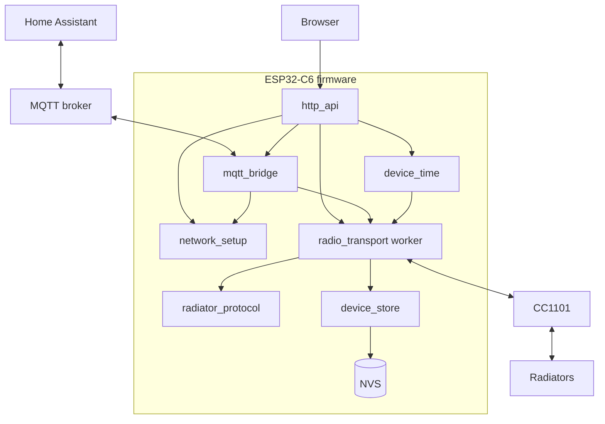

# Architecture

## Overview

HTTP and MQTT never touch the radio. They validate a request, reserve the
target radiator and put the request on the radio worker's queue. The worker is
the only code that drives the CC1101, runs the pairing and command state
machines and writes the radiator registry and operating mode.

## Components

| Component | Responsibility | Depends on |
| --- | --- | --- |
| `radiator_protocol` | Frame codec, CRCs, pairing and command state machines. Portable C, no RTOS or chip code. | – |
| `radio_transport` | CC1101 setup through RadioLib, receive/transmit worker, registry in RAM, request admission | protocol, store, time |
| `device_store` | Registry and RF-mode NVS records, initial mode persistence gate | protocol |
| `network_setup` | Wi-Fi station and setup access point policy, BOOT button, Wi-Fi credentials store | store |
| `device_time` | SNTP, manual UTC, POSIX time zone, command clock | store |
| `mqtt_bridge` | Broker settings, command routing, results, state snapshots, Home Assistant discovery | transport, network |
| `main` | Startup, HTTP handlers (`http_api.c`), embedded page (`index.html`) | all |

Dependencies: ESP-IDF 5.5.1 (FreeRTOS, Wi-Fi, HTTP server, NVS, SNTP, ESP-MQTT)
and RadioLib 7.8.1 pinned to commit `2325a38a89dd0f0e402c19f67fe910111da1e246`.
Only the CC1101 driver is enabled. See the [dependency evaluation](radiolib.md)
for compatibility, real-library tests, resources and hardware limits.

## Tasks and shared state

| Task | Stack | Priority | Loop | Owns |
| --- | --- | --- | --- | --- |
| `radio_rx` | 6144 B | 5 | every 1 ms tick | CC1101, registry RAM, pairing and command machines, registry writes |
| HTTP server | 8192 B | 5 | per request | nothing; admits work |
| `mqtt_bridge` | 8192 B | 3 | every 100 ms | MQTT settings, client lifecycle, sessions, tokens, discovery journal |
| ESP-MQTT client | 6144 B | 5 | event-driven | socket I/O; callbacks only copy input |
| `network_setup` | 4096 B | 3 | ≤ 20 ms queue wait | Wi-Fi mode, credentials, AP policy, BOOT button |

Shared radio state, passive caches, mode changes and admission are guarded by a
task mutex. Template validation and nonblocking queue calls do not disable
interrupts. The mutex is released before NVS or radio I/O. Requests pass to the worker through a FreeRTOS queue of
`capacity + 1` entries. MQTT status and input use a second spinlock. Network
and time status use mutexes. NVS, JSON and network I/O never run inside the radio
mutex. A separate mode-store mutex serializes bootstrap retries and explicit mode
writes; only that small persistence boundary holds a task mutex during NVS I/O.

## Operating mode

An absent operating-mode record always starts **listen-only**, even if other
settings exist. Only an explicit STA mode save enables control. Startup saves
this initial decision before settings owners run. All settings writes share the
mode persistence gate; failed bootstrap writes must be durably retried first.
Retries keep the same boot decision and are serialized against explicit mode
saves. A failed initial write keeps RF closed this boot until explicit mode save
or reboot. Corrupt/unreadable mode records fail closed and remain visible;
known-present invalid records permit other-key repair without changing RF mode.
Unknown presence blocks settings writes. Wi-Fi forget never changes mode.

Mode changes are explicit STA-only requests, queued to the existing worker.
They reserve admission under the task mutex and are refused while pairing,
any queued/active command, another mutation or TX is outstanding. Existing
bounded work finishes normally; retry the transition explicitly. No work is
discarded, suspended or resumed by a mode change. While mode persistence is
pending, new pairing and commands are refused. Failed writes close RF, report
`failed` and persistence uncertainty, and may leave old or new mode bytes in
flash. Only a verified successful write reports `succeeded`.

HTTP and MQTT use shared admission. The worker also checks mode immediately
before physical TX and marks TX in progress under the same mutex. Mode admission
cannot pass while that flag is set. Thus no transmission can begin after
listen-only is reported active. Enabling control only saves mode; it does not
pair, poll or create RF work. Network/MQTT events do not change
mode. Boot never resumes RF work.

## Passive commissioning

The production codec decodes reports regardless of destination controller.
A RAM observation cache uses the radiator's source RF address as identity and
retains the latest decoded readings, destination controller and monotonic
receipt time. Five minutes marks an observation stale. No heating or energy
fields are added. Observations do not create pairing, authorize commands or
produce MQTT/HA discovery automatically. Explicit selections are described below. Paired command machines still require both their
saved source and destination addresses to match.

The cache holds `2 × CLEVERBOX_RADIATOR_CAPACITY` entries (default 16).
A known address updates in place. New addresses use free slots, then replace
the least recently received entry; ties choose the lowest slot. Full status and
a saturating eviction counter expose this bound. Reports write no flash, and
observations clear on reboot. Non-report frames are receive diagnostics only;
there is no retained controller-state capture, learning or adoption path.

## Passive Home Assistant monitoring

A separate selection list holds `RADIO_MONITOR_CAPACITY` addresses and names
(equal to `CLEVERBOX_RADIATOR_CAPACITY`, default 8). The radio worker persists
explicit select, rename and remove actions in `ha_monitors`, separately from
pairings. Selection requires a decoded report in the general passive
cache or an existing selection. All actions use the full four-byte RF address;
cache slots and destination controllers never identify a device.

Each selection has a dedicated RAM observation updated directly by production
receive code, regardless of destination controller. General cache eviction
cannot stop it updating. These readings clear at reboot. There is no packet
allocation, packet history or per-report flash write. When capacity is full,
selection returns `409`; remove a selection explicitly to free space.

Global HA discovery enables publishing of selected observations and their
read-only discovery entities. Disable stops passive snapshots and cleans up
entities but preserves selections. See [entities and lifecycle](home-assistant.md#passive-monitoring).

An already paired address cannot be selected. An explicit inclusion reply from
a monitored address ends that pairing attempt before bind with `0x7306`.
Remove monitoring, disconnect Touch E3, then start pairing again explicitly.
The discovery address is not necessarily the final radiator address, so an
explicit pairing attempt can already have sent its offer. Passive operations
never send RF. Pairing removal never creates a passive selection; selection
removal never changes pairings. No automatic conversion,
mode enable or command replay occurs.

The shared mode-persistence gate runs before every selection write. Save uses
a versioned blob with generation, commit and independent handle readback. RAM
changes only after verified success. A failed write reports `failed`, storage
error and uncertainty; old RAM selections continue this boot. Further monitor
mutations stop until reboot, which loads whichever record is durable. Corrupt,
unknown or oversized records are reported, not truncated or overwritten.

Genuine reception alongside Touch E3, independent RF silence, real report
interpretation/freshness, power-cycle retention and sustained receive
responsiveness remain [hardware checks](hardware.md). Simulator/HA success does
not establish physical heating behavior.

## Radiator registry

Each radiator has a record with:

- **ID**: nonzero 32-bit integer, assigned in increasing order, never reused.
  All interfaces address radiators by ID; names are labels only.
- **Name**: 1–32 UTF-8 bytes, no control characters. New records are named
  `Radiator`.
- **Pairing**: controller address and radiator address (4 bytes each).

Persisted: ID, name and pairing. Everything else is RAM-only and
cleared at boot: latest report, command state and results.
Boot loads the registry and starts receiving. It never transmits.

Capacity is `CLEVERBOX_RADIATOR_CAPACITY` (default 8). Set it for every
component, in both C and C++ flags; on the host, for example
`make CPPFLAGS=-DCLEVERBOX_RADIATOR_CAPACITY=3 test`. A stored registry larger
than the build's capacity blocks all changes
(`registry_problem: stored_registry_exceeds_capacity`) and is never truncated.

Changes to the registry (rename or remove) run one at a
time through the worker. A record with an outstanding command cannot be removed.
Removing a record does not unpair the physical radiator.

## Generated controller frames

Normal commands use only the [explicit controller profile](controller-profile.md).
There is no template codec, import, capture, learning, saving or adoption feature.
The command carries settings only; the worker supplies saved addresses, validated
report context and the admitted clock. Unknown command fields return `400`.
`/api/controller-state` has no route; `/api/preview` supports short frames only.

Registry v2 stores no controller-state bytes. No earlier format is loaded or
migrated. Unknown versions, corrupt records and oversized registries fail closed
without changing the stored bytes. Development simulator storage from an earlier
format must be reset explicitly before use.

## Pairing

One pairing runs at a time, and only when no command is outstanding. Commands
are refused while pairing runs.

| Phase | Action | Ends when |
| --- | --- | --- |
| `offer` | Send offer to the discovery address | Sent; fails if not sent within 5 s of admission |
| `waiting_reply` | Wait for an inclusion reply addressed to the controller | Reply arrives (radiator address learned) or 5 s pass |
| `bind` | Send bind to the radiator 1 s after the reply | Sent; same 5 s deadline as the reply wait |
| `waiting_ack` | Wait for the radiator's inclusion ack | Ack arrives or 5 s pass |
| `complete` | Save the record | Saved, or save fails (retry with action `save`) |

Terminal phases: `complete`, `timeout`, `cancelled`, `error`. There are no
automatic retries. A reply from an already registered radiator address fails
the attempt before bind (`duplicate: true`). Cancel stops remaining steps; a
bind already sent stays sent. Addresses must share a family byte (`F1` or `D0`)
and the controller address must differ from the discovery address.

## Command delivery

Each radiator has at most one outstanding command. Commands to different
radiators run independently.

| Phase | Meaning | Next |
| --- | --- | --- |
| `poll` | Poll queued | Sent → `waiting_report` |
| `waiting_report` | Waiting for a report from the radiator | Report → `sending` |
| `sending` | State frame queued, generated from the request and that report | Sent → `waiting_readback` |
| `waiting_readback` | Waiting for a report showing the requested target and mode | Match → `matched`; mismatch after attempt 1 → `sending` |
| `matched` | A report showed the requested target and mode | Terminal |
| `timeout` | A wait expired | Terminal |
| `error` | Transmit or radio failure | Terminal |

Admission requires enabled RF with durable mode, ready radio, valid saved
relationship, usable device time, available per-radiator reservation and the
existing registry/pairing/queue gates. It does not require a cached report:
only a report received after the command's poll completes can advance delivery.

Context and retry policy:

- Each `waiting_report` or eligible `waiting_readback` transition snapshots the
  actual CRC-valid exact-layout report, both saved addresses and receipt time.
  Require `0A=47`. Wrong-address, corrupt or incompatible reports do not make
  a state ready. Cached observations, including young ones, are not inputs.
- While `sending` waits for RX/fair scheduling, retain that answering report and
  its original timestamp. Later mismatches do not extend or replace it. A later
  matching report after a state attempt can still reconcile before retry TX.
- Every selection rebuilds through `rf_touch_e3_state`. Context must have
  nonnegative, ordered current-boot times and age strictly below five minutes.
  The unchanged 150 s ready deadline normally expires first. No timestamp is
  refreshed to make old data look new. Physical TX retains its already built
  bytes through completion; it never rebuilds during an in-flight packet.
- A second attempt requires a newly received mismatching report after the first
  state completes and uses its new `4B`, `DF` and `E1`. No blind retry or template
  fallback exists. Local time follows the admission snapshot described below.

Rules:

- Every wait is 150 s. The first deadline counts from admission, including time
  in the queue. Each successful transmission starts a new 150 s wait.
- At most two state frames are sent. A second one is sent only after a new
  mismatching report; there are no timed retransmissions.
- After `timeout` or `error`, a later matching report changes the result to
  `matched` without sending anything.
- `matched` means the radiator reported the requested values. It does not prove
  the command caused them or that heating changed.
- Commands are not persisted or resumed after reboot.

**Transmit scheduling.** Each worker iteration takes at most one queued request,
advances all deadlines and services reception first. A partial frame in
software, bytes in the FIFO or an unstable byte count postpone transmission.
Otherwise the worker starts one ready frame, pairing first, then commands in
round-robin order. Postponing never extends a deadline. The task yields between
TX completion checks. This is half-duplex ordering, not collision avoidance:
a frame can start on air after the last FIFO check.

## Physical transmit lifecycle

The existing owner holds one physical TX record: copied bytes (at most 64),
length, stable radiator ID, pairing flag, STX uncertainty and monotonic deadline.
It contains no registry pointers or references to stack-owned frames. The
record is 88 bytes on the supported ABIs. The task/queue/capacity are unchanged.

After RX service and the final idle check, the owner reserves `tx_in_progress`
under the admission mutex, checks mode again, enters standby, selects fixed
length and calls RadioLib `startTransmit()`. It returns to the existing task;
completion is first checked on a later 1 ms tick. While TX is outstanding,
there is no receive-FIFO service or second transmission. Every other active
command keeps its deadline. The sending machine keeps its pre-send phase
until completion; its old ready-to-send deadline no longer applies once started.
The physical deadline bounds it instead. Queued commands retain admission time.

Each completion check samples GDO2 once, TXBYTES twice and MARCSTATE once.
Success requires GDO2 low, two matching empty TX FIFO counts and MARCSTATE IDLE.
An observed rising edge is not required: a whole pulse can fall between ticks.
Low by itself cannot complete a transmission. TXBYTES underflow or MARCSTATE
TXFIFO_UNDERFLOW reports `0x730B`; SPI errors retain their HAL code. A stuck
signal, busy state, nonempty or unstable FIFO expires at **100 ms**, measured
once from successful `startTransmit()` return. Polls never move that deadline;
it is checked before and after register sampling. This conservative software
limit is not a measured RF timing guarantee.

Only the successful indication invokes `finishTransmit()`. It verifies the
expected IDLE state, flushes TX and makes GDO2 high impedance. All outcomes,
including start failure and timeout, then attempt one receive-profile restoration:
standby, GDO2 high impedance, infinite packet length, and `startReceive()`
(standby, RX FIFO flush, GDO0 mapping, threshold and RX strobe). A restoration
error enters recovery. Completion proves local transmission progress, never
radiator acceptance. Only a matching later report confirms requested settings.

The original machine receives exactly one sent callback when the physical
operation resolves. A state frame counts one attempt if STX may have been
submitted, including failed completion; a confirmed pre-STX failure counts none.
Successful callbacks start the existing reply/readback deadline at resolution.
The round-robin cursor advances once, on resolution. No retry limit, pairing
exchange, frame construction or requested/observed meaning changes.

Queue execution is suspended while physical TX is outstanding. Accepted local
writes remain pending in their original bounded queue order, with no queue
rotation or discarded entries. Flash calls, registry removal
and compaction run only on later iterations after TX resolution and RX restoration
(or during recovery if restoration failed). Admission may queue another radiator's
command; its original ID/cookie and admission time remain intact. A reserved
radiator cannot be removed or given another command. Resolve by stable ID before
any queued mutation can shift records. Failed writes retain their actual failed
store outcome. This scheduling covers this owner's writes; unrelated settings
owners and hardware flash/cache stalls still require responsiveness measurements.

`tx_in_progress` remains set through finalization, restoration and publication of
the original result/fault. Mode changes remain refused throughout. Pair cancel
may queue during TX and stops remaining steps after the physical operation resolves;
it cannot retract bytes already sent. Recovery, reconnect and boot never resume
an outstanding physical record or create RF work.

## Receive path

The worker polls the CC1101 FIFO over SPI every 1 ms tick; interrupts are not
used. It reads `RXBYTES` until two consecutive reads agree (at most nine reads)
and always leaves one byte in the FIFO while a frame is incomplete (TI erratum
SWRZ020E). A frame is length byte `L` (≥ 11) plus `L + 2` bytes, up to 258 bytes.
After a complete frame, an overflow, an invalid count or 100 ms without
completion, the worker flushes the FIFO and restarts reception.

Each valid frame updates global diagnostics (`last_frame`, `report`). A report
whose source and destination match a record's radiator and controller addresses
becomes that radiator's observation and feeds its command machine. Observations
older than 5 minutes are marked `stale`.

## Radio health and recovery

The existing worker owns initial radio setup, every SPI transaction and recovery.
Startup creates that worker even when the first CC1101 setup fails. HTTP, Wi-Fi
and MQTT run independently. No additional worker, queue, ISR or radio wiring is
introduced. RadioLib stays pinned to 7.8.1 and the packet profile is unchanged.

Health is `initializing`, `ready`, `recovering` or `faulted`. `ready` means setup
and entry to RX succeeded, not that any radiator has been heard. Driver/resource
allocation failures before the worker exists report `faulted`/`resources`; an
explicit radio retry cannot repair failed task or mutex allocation.

Each automatic batch has **four setup attempts**. Boot attempts immediately;
a runtime fault waits one second before its first attempt. Failed attempts wait
**1, 2 and 4 seconds**, measured from completion, before the next attempt.
After attempt four there is no automatic retry. The initial batch therefore
has seven seconds of backoff; a runtime batch has eight, plus setup durations
and task scheduling. A successfully recovered radio gets a fresh batch on a
new independent fault. Counters saturate at `UINT32_MAX`.

Only `POST /api/radio` with `{"action":"retry"}` on STA can start a new batch
after exhaustion. It reserves the retry under the admission mutex. Duplicate
requests while pending/recovering or requests while ready return `409`.
Retry neither changes RF mode nor creates pairing, polls or commands.

A fault closes RF admission, records its stage/code and ends all outstanding
commands and pairing. RF handoffs still in the bounded queue are removed.
Reservations clear; successful recovery never resumes them. Other queued
local actions keep their order and run normally, including during exhaustion.
Their pending/save results describe the actual persistence call, not radio
health. A validated matching report remains matched if RX restoration then fails.
An inclusion already saved successfully remains complete/saved even
if restoring RX immediately after its acknowledgement fails. Unsaved pairing
work ends; retry pairing explicitly. IDs, pairings, selections and
all unrelated storage survive recovery unchanged.

An error before submitting the CC1101 STX command is a confirmed failure to
attempt that frame. The HAL records STX submission before the driver call;
a start/completion error cannot prove silence after that boundary. A failure
or failed RX restoration after possible STX reports
`RADIO_ERR_DELIVERY_UNCERTAIN` (`0x730A`) for that command/pairing: bytes may
already have gone on air. Commands which previously attempted a state frame
also report uncertainty when ended by another radio fault. The underlying
failure remains in radio stage/code diagnostics: `transmit` for preparation,
`tx_start` for `startTransmit()`, `tx_complete` for polling/finalization and
`rx_restore` for restoration alone. If TX and restoration both fail, retain the
original TX stage/code. No error confirms radiator
settings; later matching reports can still reconcile results without sending.

### Failure boundaries

| Path | Handling |
| --- | --- |
| Initial detection/configuration or entry to RX fails | Finite setup batch; network interfaces remain running |
| Partial/truncated frame, overflow, invalid count, unstable count, bad CRC | Existing bounded FIFO cleanup; no reinitialization if RX restoration succeeds |
| Receive standby/startReceive/register operation fails | End RF work, discard partial software frame, recover |
| SPI init/add/start/completion returns an error, or operation deadline expires | Sticky HAL error suppresses further SPI for that operation; recover before accepting any read bytes |
| TX preparation, start, completion or post-TX RX restoration fails | End RF work with delivery uncertainty where appropriate; recover even if RX restoration itself succeeded |

Every setup attempt reapplies the established frequency/modulation/packet
configuration and enters RX. It transmits no probe and does not update report
or candidate timestamps. Partial bytes are discarded; previously validated
observations remain available for inspection with their original age.

### Adapter bounds and limits

The HAL replaces aborting SPI `ESP_ERROR_CHECK` calls with a sticky error.
It checks owner-operation deadlines of **1200 ms for setup**, **250 ms for
receive service/final idle sampling and each TX status sample**, and separate
**1000 ms operations for TX start and RX restoration**. These suppress further
SPI; they do not unwind a library call. RadioLib's reachable waits are separately
finite: ten chip-detection reads with 10 ms delays, 100 ms per standby,
1600 µs TX calibration and register readback checks (default 2 ms each).
`startTransmit()` itself calls standby (and ignores that call's return), flushes
TX, waits for calibration, maps GDO2, fills the FIFO and submits STX. Our checked
outer standby and sticky HAL errors remain necessary. There is no FIFO refill
for fixed frames up to 64 bytes with address filtering off. `finishTransmit()`
still synchronously waits for IDLE (truncated timeout 3 ms at this bitrate), then
calls standby and performs cleanup. It is called only after the owner observes
IDLE/empty FIFO. Restoration calls checked standby and `startReceive()`'s own
standby. These finite calls and scheduler/driver latency remain synchronous;
only the GDO completion wait moves into task iterations. HAL `yield()` gives other tasks a tick. The unbounded
large-packet refill stable-count loop is unreachable because every transmitted
frame is fixed length and at most 64 bytes with address filtering disabled.

SPI completion uses `spi_device_polling_end` with `pdMS_TO_TICKS(20)+1`, allowing
one extra driver timeout tick. A timed-out transaction's descriptor and two
64-byte buffers stay in the static HAL. No later attempt reuses them until
completion is confirmed. A still-stuck transaction consumes an attempt without
issuing another transfer. The driver bus/device live for the worker lifetime;
RadioLib detection failure cannot tear down an in-flight transaction.

ESP-IDF 5.5.1 rejects finite acquire/start timeout arguments ([driver source](https://github.com/espressif/esp-idf/blob/v5.5.1/components/esp_driver_spi/src/gpspi/spi_master.c)).
The HAL acquires SPI2 once in the owner. There is exactly one device, no queued
SPI transfers and no competing bus owner; polling start has no background work
to await. This is an ownership invariant, not a hard cancellation guarantee for
an arbitrary driver deadlock. IDF's internal assertions, a stalled scheduler,
memory corruption or a driver call that never returns cannot be caught by this
policy. No forced task deletion, bus teardown or watchdog disabling is used.
A permanently broken bus/radio can exhaust the budget and require hardware
repair/reset. A bus returning plausible zeros or a silent RF front end may
produce no observable error; quiet traffic alone never triggers recovery.

### Health and observations

[HTTP diagnostics](http-api.md#radio-health) and the existing MQTT bridge
snapshot expose health, readiness, last failure, attempts/successes and retry
timing. Only fault transitions and setup outcomes log; receive cleanup uses
saturating counters rather than per-packet error logs. Historical last failure
stays visible after success; `error` clears when ready.

HA reading sensors become unavailable on a radio outage. Existing freshness
entities show off with radio-health attributes; report-age and result diagnostics
remain visible. Snapshots retain the original readings and ages. Recovery can
make a still-young reading available again, but cannot make an expired one fresh.
The normal five-minute monotonic age rule and 15-second publication-loss expiry
still apply. There is no added HA entity. See [HA semantics](home-assistant.md#radio-outages).

These guarantees are covered by software fault injection, not physical bus/RF
measurements. Run the [hardware recovery checks](hardware.md#radio-fault-acceptance)
before unattended installation.

## Time

Commands carry the local time of day (`B2`). Time is usable only after an SNTP
sync or a manual UTC set during the current boot; no RTC or stored time is
trusted. Without usable time, all physical HTTP and MQTT commands are refused.
Physical HTTP rejects `clock_seconds` explicitly. Only the host simulator
accepts that override for tests.

- SNTP (`pool.ntp.org`) starts on each station IP event and resyncs hourly.
- Manual UTC (`/api/time`, action `manual`) is valid until reboot or the next
  SNTP sync. Accepted dates: 2020–2099.
- The time zone is a POSIX rule (default `UTC0`), stored in NVS.
- Admission records local seconds since midnight and the monotonic time. Each
  state frame adds elapsed whole seconds, wrapping at midnight. Later clock or
  time zone changes do not affect commands already admitted.
- All deadlines and ages use the monotonic timer, so clock changes never expire
  or restart work.

Supported time zone syntax (max 95 bytes):
`STDoffset[DST[offset],Mm.w.d[/time],Mm.w.d[/time]]`. Names are 3–10 letters.
The offset sign follows POSIX, so `CET-1` means UTC+1. Sweden:
`CET-1CEST,M3.5.0/2,M10.5.0/3`.

## Network

The setup access point uses SSID `Cleverbox`, WPA2 password `cleverbox`,
channel 1, 2 clients and http://192.168.4.1/. The password is public and fixed.
It grants Wi-Fi setup and diagnostics only ([HTTP boundary](http-api.md#interface-policy)).

| Event | Behaviour |
| --- | --- |
| Boot with absent Wi-Fi key | Setup access point on |
| Boot with valid saved credentials | Connect using STA only; no AP window |
| Wi-Fi key corrupt or unreadable | Report `storage_invalid`; no automatic AP, erase or overwrite; BOOT still opens recovery |
| Connection attempt | 15 s deadline; 5 s between attempts; 3 attempts per batch, then 60 s pause; no new AP access |
| Station loses connection or IP | Clear station IP; reconnect after 5 s; do not open AP |
| BOOT held ≥ 5 s then released | Open recovery and keep it open; station and admitted commands unaffected |
| Successful explicit Wi-Fi save | End recovery; close an already open AP after 60 s, even if STA disconnects during that grace period |
| **Finish recovery** | Close AP after 60 s regardless of STA or storage state; UI confirms that the current access path may disappear |
| **Forget home Wi-Fi only** | Erase only the Wi-Fi key and retain recovery access, including after a failed erase |

Starting a replacement trial keeps an already authorised AP session open.
Failed credentials or a failed save, including uncertain persistence, retain
that access through fallback reconnects. Errors do not open a new AP for a
station-only session. A new trial or BOOT cancels a pending AP closure; ordinary
reconnects do not. AP opening retries at one-second intervals after a platform
failure. Reboot clears deliberate access; the saved key decides startup policy.

The adapter loads credentials before starting Wi-Fi. It resets STA through
`NULL`/`STA` when AP is closed, or `AP`/`APSTA` while recovery is authorised.
Retry and stop paths never enable AP as a side effect. Wi-Fi driver NVS is
disabled: the application owns the Wi-Fi key. If NVS partition initialisation
fails, startup logs the error and continues to diagnostics and BOOT recovery
without erasing flash; persistent changes may remain unavailable.

New credentials are tried from RAM and written only after DHCP succeeds. A
failed trial keeps the previous credentials. Only WPA2-personal 2.4 GHz networks
are supported (SSID 1–32 bytes, password 8–63 printable ASCII characters).

The button is GPIO9 (active low, pull-up), debounced for 40 ms. A press held at
boot does not count; the button arms after a stable release. Holding BOOT
during reset can enter ROM download mode because GPIO9 is a strapping pin.

No network or time event creates, cancels or replays an RF command.

## Storage

All keys live in NVS namespace `cleverbox`. Nothing erases the NVS partition
automatically.

| Key | Layout | Written when |
| --- | --- | --- |
| `rf_mode` | v1: version (1), control-enabled flag (0 or 1); 2 bytes | Initial listen-only decision and explicit STA mode saves |
| `registry` | v2: version (2), count (LE16), next ID (LE32), then per record: ID (LE32), name (33, NUL-terminated), controller and radiator address (4 + 4). Size `7 + 45 × count`. | Pairing saved, rename, remove |
| `wifi` | v1: version (1), SSID (33), password (64) | Wi-Fi saved or forgotten |
| `timezone` | v1: version (1), NUL-terminated POSIX rule | Time zone saved |
| `mqtt` | v1: version, flags, port (LE16), host (97), username (65), password (129); 295 bytes | Broker configured, enabled, disabled or forgotten |
| `ha_monitors` | v1: version, count (LE16), generation (LE32), then address (4) and name (33) per selection. `7 + 37 × count` bytes. | Explicit monitor select, rename or remove |
| `ha_discovery` | v2: version, enabled, 2 zero bytes, generation (LE32), then `4 × capacity` tagged identities (LE64). High word 0: paired ID; 1: passive full RF address in low word. Existing v1 paired journal remains readable and upgrades on its next write. | Discovery enabled/disabled; topic ownership added or acknowledged cleanup removed |

Write policy:

- The registry is replaced as one blob. If the commit fails, the previous bytes
  are restored. RAM changes only after a successful commit.
- Wi-Fi, time zone and MQTT writes erase, rewrite and read back the key. A
  failed Wi-Fi write also restores and checks the previous value. If the result
  cannot be confirmed, status reports `persistence_uncertain`; the next boot may
  load the old, new or no value.
- Corrupt or unknown records are reported and left untouched.

## Security

- HTTP has no authentication and no HTTPS. Station-interface control assumes
  a trusted LAN: every host able to reach that interface can change settings
  and control radiators. Do not forward the port or expose it to an untrusted LAN.
- AP access is deliberate after configuration and restricted to Wi-Fi setup
  and diagnostics by the central [endpoint allowlist](http-api.md#interface-policy).
  A joined AP client can replace/forget Wi-Fi and inspect household diagnostics.
  BOOT authorises a recovery session, not an individual user.
- These boundaries address issue #20's automatic AP exposure and physical clock
  bypass. They do not provide HTTP authentication or complete its broader
  authorisation item. OTA and its authorisation remain separate decisions.
- MQTT uses TCP without TLS; credentials cross the network in clear text.
- NVS encryption, flash encryption and secure boot are off.
- Passwords are never returned by the API and Wi-Fi driver logging is
  suppressed. The Wi-Fi password is cleared from request buffers after use.
- Content-Type must be exactly `application/json`, which blocks simple
  cross-site form posts.

## Host simulation

The host build compiles the production protocol, radio worker, registry, HTTP
handlers, network policy, time logic and MQTT bridge into a shared library.
`host/serve.py` serves it on 127.0.0.1 and runs everything on one thread.

Replaced on the host: RadioLib and the CC1101 (a FIFO model), FreeRTOS queues
and locks, the monotonic clock, NVS (file-backed), the Wi-Fi driver and the
MQTT client (fake, or real sockets with `--real-mqtt`).

Two invented radiators answer offers, binds, polls and valid state frames with
replies and reports. Their report writer uses its own CRC code. Expected frame vectors remain explicit in tests; the simulator has no
controller-state fixture injection workflow.

Because the simulation is single-threaded, it does not exercise task
scheduling, lock contention, stack depth or RF timing. Loopback tests exercise
real `getsockname`/`getpeername` (including IPv4-mapped IPv6 sockets),
production dispatch and handlers, but substitute
netif addresses and Wi-Fi events. They cannot prove ESP/lwIP ingress routing,
AP/STA isolation, DHCP event timing, phone access or GPIO behaviour.
`make test-http` also compiles `http_api.c` without `CLEVERBOX_HOST`, tests clock
override rejection and device-time admission, and retains host-only RF
observability outside the physical API.

`serve.py` options: `--port` (default 8080), `--storage`, `--real-mqtt`,
`--test-clock`, `--test-interfaces` (extra loopback destinations for AP/unknown
classification). Storage defaults to `local/simulation-pairing.bin`; each NVS key
gets its own file next to it (`.registry`, `.wifi`, `.mqtt`, `.timezone`,
`.ha_discovery`, `.ha_monitors`, `.rf_mode`). Stop the simulator and delete these files to reset.

## Constants

| Value | Setting |
| --- | --- |
| 150 s | Command report and readback wait |
| 2 | State frames per command |
| 5 min | Observation `stale` threshold |
| 5 s | Pairing reply and ack waits; offer deadline |
| 1 s | Delay before bind |
| 100 ms | Incomplete-frame receive timeout |
| 1 ms | Radio worker poll interval |
| 4 | Radio setup attempts per batch |
| 1 / 2 / 4 s | Radio setup retry delays |
| 100 ms | MQTT owner tick |
| 5 s | MQTT state snapshot interval, reconnect pause, SUBACK and PUBACK timeouts |
| 15 s | Wi-Fi attempt deadline |
| 60 s | Access point grace period; pause between connection batches |
| 5 s | BOOT hold for recovery |
| 8 | Default radiator capacity |
