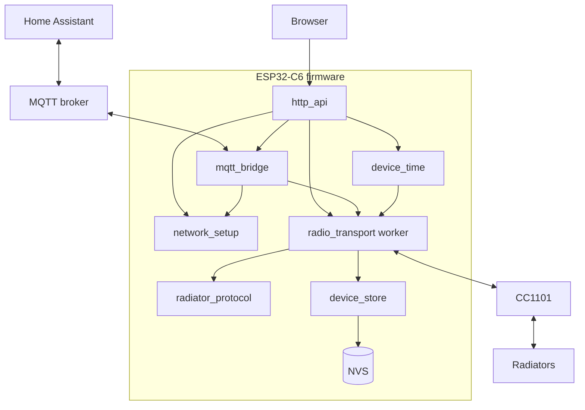

# Architecture

## Overview

HTTP and MQTT never touch the radio. They validate a request, reserve the
target radiator and put the request on the radio worker's queue. The worker is
the only code that drives the CC1101, runs the pairing and command state
machines and writes the radiator registry.

## Components

| Component | Responsibility | Depends on |
| --- | --- | --- |
| `radiator_protocol` | Frame codec, CRCs, pairing and command state machines. Portable C, no RTOS or chip code. | – |
| `radio_transport` | CC1101 setup through RadioLib, receive/transmit worker, registry in RAM, request admission | protocol, store, time |
| `device_store` | Versioned registry record in NVS, legacy migration | protocol |
| `network_setup` | Wi-Fi station and setup access point policy, BOOT button, Wi-Fi credentials store | – |
| `device_time` | SNTP, manual UTC, POSIX time zone, command clock | – |
| `mqtt_bridge` | Broker settings, command routing, results, state snapshots, Home Assistant discovery | transport, network |
| `main` | Startup, HTTP handlers (`http_api.c`), embedded page (`index.html`) | all |

Dependencies: ESP-IDF 5.5.1 (FreeRTOS, Wi-Fi, HTTP server, NVS, SNTP, ESP-MQTT)
and RadioLib 7.3.0 pinned to commit `2a2f6e0edf5a527cd83d2a04a7e2eb5d220329cd`.
Only RadioLib's CC1101 driver is compiled.

## Tasks and shared state

| Task | Stack | Priority | Loop | Owns |
| --- | --- | --- | --- | --- |
| `radio_rx` | 6144 B | 5 | every 1 ms tick | CC1101, registry RAM, pairing and command machines, registry writes |
| HTTP server | 8192 B | 5 | per request | nothing; admits work |
| `mqtt_bridge` | 8192 B | 3 | every 100 ms | MQTT settings, client lifecycle, sessions, tokens, discovery journal |
| ESP-MQTT client | 6144 B | 5 | event-driven | socket I/O; callbacks only copy input |
| `network_setup` | 4096 B | 3 | ≤ 20 ms queue wait | Wi-Fi mode, credentials, AP policy, BOOT button |

Shared radio state (registry records and the status block) is guarded by a
`portMUX` spinlock. Requests pass to the worker through a FreeRTOS queue of
`capacity + 1` entries. MQTT status and input use a second spinlock. Network
and time status use mutexes. NVS, JSON and network I/O never run inside a lock.

## Radiator registry

Each radiator has a record with:

- **ID**: nonzero 32-bit integer, assigned in increasing order, never reused.
  All interfaces address radiators by ID; names are labels only.
- **Name**: 1–32 UTF-8 bytes, no control characters. New records are named
  `Radiator`.
- **Pairing**: controller address and radiator address (4 bytes each).
- **Saved template** (optional): see [Templates](#templates).

Persisted: ID, name, pairing, saved template. Everything else is RAM-only and
cleared at boot: learned template, latest report, command state and results.
Boot loads the registry and starts receiving. It never transmits.

Capacity is `CLEVERBOX_RADIATOR_CAPACITY` (default 8). Set it for every
component, in both C and C++ flags; on the host, for example
`make CPPFLAGS=-DCLEVERBOX_RADIATOR_CAPACITY=3 test`. A stored registry larger
than the build's capacity blocks all changes
(`registry_problem: stored_registry_exceeds_capacity`) and is never truncated.

Changes to the registry (rename, remove, save or clear a template) run one at a
time through the worker. A record with an outstanding command cannot be removed.
Removing a record does not unpair the physical radiator.

## Templates

A template is a CRC-valid 59-byte controller-state frame whose destination is
the radiator's address. Commands are built from it.

**Selection** at command admission, first match wins:

1. `state` supplied in the HTTP command (one command only; not persisted)
2. Learned template (RAM)
3. Saved template (NVS)

With none available the command is refused.

**Learning.** The worker stores, in RAM, the latest controller-state frame
whose source is the record's controller address and whose destination is its
radiator address. Learning never writes flash and never sends anything.
Cleverbox does not receive its own transmissions, so for a radiator paired by
Cleverbox nothing ever sends a learnable frame. Import a template for those
radiators (`/api/controller-state`, action `import`); the import checks
structure, CRCs and destination, and accepts any source.

**Saving.** `save` copies the learned template to NVS. `import` validates and
saves a supplied frame. `clear` removes both saved and learned templates.

**Frame construction.** Offsets include the length byte.

| Bytes | Field | Value sent |
| --- | --- | --- |
| 0, 5 | Length `38`, marker `C6` | Fixed |
| 1–4, 6–9 | Source, destination | Controller and radiator address from the pairing |
| 11–12, 17, 19–20 | `45`, `3B`, `4C` | Template |
| 14–15 | `4B` measured temperature | Copied from the fresh report, including `084C` (unavailable) |
| 22–24, 26–29 | `8E`, `CC` | Template |
| 31–33 | `97` | Template. No known construction rule. |
| 35–37 | `94` target and mode | Raw target `320 + 18 × °C` rounded (tenths of °F); Off sends raw 320. Mode byte 0 Comfort, 1 Off, 2 Frost, 3 Eco |
| 39–42 | `E1` | Copied from the fresh report |
| 44–47 | `DA` | Zero |
| 49–50 | `5B` | Template. No known construction rule; varies slightly over time. |
| 52–54 | `B2` clock | Local hour, minute, second (see [Time](#time)) |
| 55–56 | Inner CRC | CRC-16/MODBUS over bytes 1–54, little-endian |
| 57–58 | Outer CRC | CRC-16/CMS over bytes 0–56, big-endian |

Non-Off targets must be 5–30 °C. Zeroing `DA` matches the controller frames in
the protocol reference. Copying `E1` from the report is an assumption. Neither
is confirmed on hardware.

## Pairing

One pairing runs at a time, and only when no command is outstanding. Commands
are refused while pairing runs.

| Phase | Action | Ends when |
| --- | --- | --- |
| `offer` | Send offer to the discovery address | Sent; fails if not sent within 5 s of admission |
| `waiting_reply` | Wait for an inclusion reply addressed to the controller | Reply arrives (radiator address learned) or 5 s pass |
| `bind` | Send bind to the radiator 1 s after the reply | Sent; same 5 s deadline as the reply wait |
| `waiting_ack` | Wait for the radiator's inclusion ack | Ack arrives or 5 s pass |
| `complete` | Save the record | Saved, or save fails (retry with action `save`) |

Terminal phases: `complete`, `timeout`, `cancelled`, `error`. There are no
automatic retries. A reply from an already registered radiator address fails
the attempt before bind (`duplicate: true`). Cancel stops remaining steps; a
bind already sent stays sent. Addresses must share a family byte (`F1` or `D0`)
and the controller address must differ from the discovery address.

## Command delivery

Each radiator has at most one outstanding command. Commands to different
radiators run independently.

| Phase | Meaning | Next |
| --- | --- | --- |
| `poll` | Poll queued | Sent → `waiting_report` |
| `waiting_report` | Waiting for a report from the radiator | Report → `sending` |
| `sending` | State frame queued, built from template and that report | Sent → `waiting_readback` |
| `waiting_readback` | Waiting for a report showing the requested target and mode | Match → `matched`; mismatch after attempt 1 → `sending` |
| `matched` | A report showed the requested target and mode | Terminal |
| `timeout` | A wait expired | Terminal |
| `error` | Transmit or radio failure | Terminal |

Rules:

- Every wait is 150 s. The first deadline counts from admission, including time
  in the queue. Each successful transmission starts a new 150 s wait.
- At most two state frames are sent. A second one is sent only after a new
  mismatching report; there are no timed retransmissions.
- After `timeout` or `error`, a later matching report changes the result to
  `matched` without sending anything.
- `matched` means the radiator reported the requested values. It does not prove
  the command caused them or that heating changed.
- Commands are not persisted or resumed after reboot.

**Transmit scheduling.** Each worker iteration takes at most one queued request,
advances all deadlines and services reception first. A partial frame in
software, bytes in the FIFO or an unstable byte count postpone transmission.
Otherwise the worker sends one ready frame, pairing first, then commands in
round-robin order. Postponing never extends a deadline. Transmission blocks
until done and then restores receive mode. This is half-duplex ordering, not
collision avoidance: a frame can start on air after the last FIFO check.

## Receive path

The worker polls the CC1101 FIFO over SPI every 1 ms tick; interrupts are not
used. It reads `RXBYTES` until two consecutive reads agree (at most nine reads)
and always leaves one byte in the FIFO while a frame is incomplete (TI erratum
SWRZ020E). A frame is length byte `L` (≥ 11) plus `L + 2` bytes, up to 258 bytes.
After a complete frame, an overflow, an invalid count or 100 ms without
completion, the worker flushes the FIFO and restarts reception.

Each valid frame updates global diagnostics (`last_frame`, `report`). A report
whose source and destination match a record's radiator and controller addresses
becomes that radiator's observation and feeds its command machine. Observations
older than 5 minutes are marked `stale`.

If the CC1101 cannot be set up at boot, HTTP stays available and `ready` is
false. If restarting reception fails at runtime, every outstanding command ends
with `error` and the radio task stops until reboot.

## Time

Commands carry the local time of day (`B2`). Time is usable only after an SNTP
sync or a manual UTC set during the current boot; no RTC or stored time is
trusted. Without usable time, UI and MQTT commands are refused. The only
bypass is the `clock_seconds` field of `POST /api/command`, intended for tests.

- SNTP (`pool.ntp.org`) starts on each station IP event and resyncs hourly.
- Manual UTC (`/api/time`, action `manual`) is valid until reboot or the next
  SNTP sync. Accepted dates: 2020–2099.
- The time zone is a POSIX rule (default `UTC0`), stored in NVS.
- Admission records local seconds since midnight and the monotonic time. Each
  state frame adds elapsed whole seconds, wrapping at midnight. Later clock or
  time zone changes do not affect commands already admitted.
- All deadlines and ages use the monotonic timer, so clock changes never expire
  or restart work.

Supported time zone syntax (max 95 bytes):
`STDoffset[DST[offset],Mm.w.d[/time],Mm.w.d[/time]]`. Names are 3–10 letters.
The offset sign follows POSIX, so `CET-1` means UTC+1. Sweden:
`CET-1CEST,M3.5.0/2,M10.5.0/3`.

## Network

The setup access point (SSID `Cleverbox`, WPA2 password `cleverbox`, channel 1,
2 clients, http://192.168.4.1/) starts at boot. The same HTTP server answers on
the access point and the station interface.

| Event | Behaviour |
| --- | --- |
| Boot with saved credentials | Access point on; connect |
| Connection attempt | 15 s deadline; 5 s between attempts; 3 attempts per batch, then 60 s pause |
| Station gets IP | New credentials saved; access point closes after 60 s |
| Station loses connection or IP | Access point reopens at once; reconnect after 5 s |
| BOOT held ≥ 5 s then released | Access point opens and stays open; station unaffected |
| **Finish recovery** | Release the button latch; access point closes 60 s later if the station is connected |
| **Forget home Wi-Fi only** | Erase the Wi-Fi key only; access point stays open |

New credentials are tried from RAM and written only after DHCP succeeds. A
failed trial keeps the previous credentials. Only WPA2-personal 2.4 GHz networks
are supported (SSID 1–32 bytes, password 8–63 printable ASCII characters).

The button is GPIO9 (active low, pull-up), debounced for 40 ms. A press held at
boot does not count; the button arms after a stable release. Holding BOOT
during reset can enter ROM download mode because GPIO9 is a strapping pin.

No network or time event creates, cancels or replays an RF command.

## Storage

All keys live in NVS namespace `cleverbox`. Nothing erases the NVS partition
automatically.

| Key | Layout | Written when |
| --- | --- | --- |
| `registry` | v1: version (1), count (LE16), next ID (LE32), then per record: ID (LE32), name (33, NUL-terminated), controller and radiator address (4 + 4), saved flag (1), template (59). Size `7 + 105 × count`. | Pairing saved, rename, remove, template save/import/clear |
| `pairing` | Legacy v1: version, controller, radiator (9 bytes). Read once for migration, never written. | – |
| `control_state` | Legacy v1: version, addresses, template (68 bytes) or 9-byte clear marker. Read for migration only. | – |
| `wifi` | v1: version (1), SSID (33), password (64) | Wi-Fi saved or forgotten |
| `timezone` | v1: version (1), NUL-terminated POSIX rule | Time zone saved |
| `mqtt` | v1: version, flags, port (LE16), host (97), username (65), password (129); 295 bytes | Broker configured, enabled, disabled or forgotten |
| `ha_discovery` | v1: version, enabled, 2 zero bytes, generation (LE32), then `2 × capacity` radiator IDs (LE32) | Discovery enabled or disabled; a radiator added to or removed from discovery |

Write policy:

- The registry is replaced as one blob. If the commit fails, the previous bytes
  are restored. RAM changes only after a successful commit.
- Wi-Fi, time zone and MQTT writes erase, rewrite and read back the key. A
  failed Wi-Fi write also restores and checks the previous value. If the result
  cannot be confirmed, status reports `persistence_uncertain`; the next boot may
  load the old, new or no value.
- Corrupt or unknown records are reported and left untouched.
- Migration: if `registry` is absent and `pairing` is valid, boot creates
  record 1 (`Radiator 1`) and commits `registry`. Legacy keys stay. An existing
  `registry`, even empty, always wins, so removed radiators do not come back.

## Security

- HTTP has no authentication and no HTTPS. Anyone who can reach the device,
  through the home network or the setup access point, can pair, send commands
  and change Wi-Fi and MQTT settings.
- The access point password is fixed and published.
- MQTT uses TCP without TLS; credentials cross the network in clear text.
- NVS encryption, flash encryption and secure boot are off.
- Passwords are never returned by the API and Wi-Fi driver logging is
  suppressed. The Wi-Fi password is cleared from request buffers after use.
- Content-Type must be exactly `application/json`, which blocks simple
  cross-site form posts.

## Host simulation

The host build compiles the production protocol, radio worker, registry, HTTP
handlers, network policy, time logic and MQTT bridge into a shared library.
`host/serve.py` serves it on 127.0.0.1 and runs everything on one thread.

Replaced on the host: RadioLib and the CC1101 (a FIFO model), FreeRTOS queues
and locks, the monotonic clock, NVS (file-backed), the Wi-Fi driver and the
MQTT client (fake, or real sockets with `--real-mqtt`).

Two invented radiators answer offers, binds, polls and valid state frames with
replies and reports. Their report writer uses its own CRC code. The synthetic
fixture and its `97`/`5B` values exist only in the simulator and tests.

Because the simulation is single-threaded, it does not exercise task
scheduling, lock contention, stack depth or RF timing.

`serve.py` options: `--port` (default 8080), `--storage`, `--real-mqtt`,
`--test-clock`. Storage defaults to `local/simulation-pairing.bin`; each NVS key
gets its own file next to it (`.registry`, `.wifi`, `.mqtt`, `.timezone`,
`.ha_discovery`). Stop the simulator and delete these files to reset.

## Constants

| Value | Setting |
| --- | --- |
| 150 s | Command report and readback wait |
| 2 | State frames per command |
| 5 min | Observation `stale` threshold |
| 5 s | Pairing reply and ack waits; offer deadline |
| 1 s | Delay before bind |
| 100 ms | Incomplete-frame receive timeout |
| 1 ms | Radio worker poll interval |
| 100 ms | MQTT owner tick |
| 5 s | MQTT state snapshot interval, reconnect pause, SUBACK and PUBACK timeouts |
| 15 s | Wi-Fi attempt deadline |
| 60 s | Access point grace period; pause between connection batches |
| 5 s | BOOT hold for recovery |
| 8 | Default radiator capacity |
